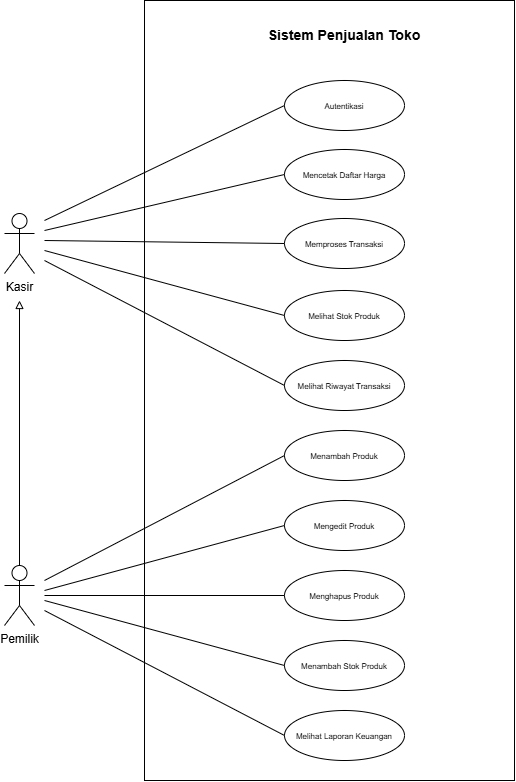
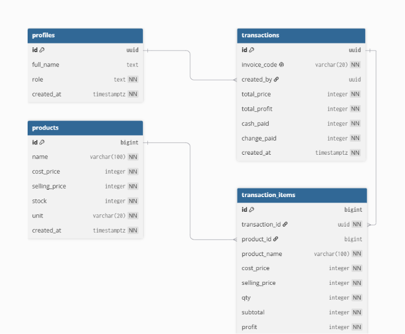

<p align="center">
  
</p>

# Waroeng.Ku

**Kelola Warung Lebih Mudah**

Waroeng.Ku adalah aplikasi perangkat bergerak untuk membantu pemilik warung dan kasir mengelola produk, stok, transaksi penjualan, serta laporan keuangan. Proyek ini dikembangkan sebagai tugas besar mata kuliah **Pemrograman Aplikasi Perangkat Bergerak (PAPB)** menggunakan **Flutter** dengan **Supabase** sebagai backend yang direncanakan.

Proyek ini melanjutkan rancangan aplikasi PWA sebelumnya ke Flutter dengan target Android dan iOS. Ruang lingkup fungsional dan struktur data mengacu pada [diagram use case](usecase.png) dan [ERD](erd.png) dalam repositori.

> **Status saat ini:** implementasi lokal masih berupa antarmuka login dan dashboard dengan data contoh. Autentikasi Supabase, penyimpanan data, dan fitur bisnis pada diagram belum terhubung ke aplikasi.

## Daftar Isi

- [Gambaran Aplikasi](#gambaran-aplikasi)
- [Aktor dan Hak Akses](#aktor-dan-hak-akses)
- [Alur Penggunaan](#alur-penggunaan)
- [Rancangan Database](#rancangan-database)
- [Teknologi](#teknologi)
- [Status Implementasi](#status-implementasi)
- [Struktur Proyek](#struktur-proyek)
- [Menjalankan Aplikasi](#menjalankan-aplikasi)
- [Pengujian](#pengujian)
- [Rencana Pengembangan](#rencana-pengembangan)

## Gambaran Aplikasi

Waroeng.Ku dirancang untuk memusatkan pencatatan penjualan dan persediaan warung dalam satu aplikasi. Kasir dapat memproses penjualan serta melihat informasi produk dan transaksi. Pemilik memiliki seluruh kemampuan Kasir, ditambah pengelolaan produk, penambahan stok, dan akses laporan keuangan.

Tujuan aplikasi:

- Mempermudah pencatatan barang yang terjual dan pembayaran pelanggan.
- Membantu memantau persediaan serta menambah stok produk.
- Menyimpan riwayat transaksi beserta rincian barang dan petugasnya.
- Menyediakan daftar harga yang dapat dicetak.
- Membantu Pemilik memantau nilai penjualan dan laba kotor dari transaksi.

## Aktor dan Hak Akses



Diagram menunjukkan dua aktor, yaitu **Kasir** dan **Pemilik**. Relasi generalisasi dari Pemilik ke Kasir berarti Pemilik mewarisi seluruh hak akses Kasir.

| Use case | Kasir | Pemilik | Keterangan |
| --- | :---: | :---: | --- |
| Autentikasi | Ya | Ya | Masuk ke aplikasi sesuai identitas dan peran pengguna. |
| Mencetak daftar harga | Ya | Ya | Mencetak informasi harga produk. |
| Memproses transaksi | Ya | Ya | Mencatat produk, jumlah pembelian, total, pembayaran, dan kembalian. |
| Melihat stok produk | Ya | Ya | Melihat persediaan produk yang tersedia. |
| Melihat riwayat transaksi | Ya | Ya | Meninjau transaksi yang telah dicatat. |
| Menambah produk | Tidak | Ya | Membuat data produk baru. |
| Mengedit produk | Tidak | Ya | Memperbarui informasi produk. |
| Menghapus produk | Tidak | Ya | Menghapus produk sesuai aturan relasi data yang akan diterapkan. |
| Menambah stok produk | Tidak | Ya | Mencatat penambahan persediaan. |
| Melihat laporan keuangan | Tidak | Ya | Meninjau rekap penjualan dan laba transaksi. |

Pengelolaan akun pegawai belum tercantum sebagai use case tersendiri. Menu **Pegawai** pada dashboard saat ini merupakan elemen antarmuka awal; mekanisme pembuatan akun dan pengaturan peran masih perlu ditetapkan saat integrasi autentikasi. Batas riwayat transaksi yang dapat dilihat Kasir juga belum dirinci dalam diagram.

## Alur Penggunaan

Alur berikut menjelaskan perilaku yang dituju berdasarkan use case dan data pada ERD.

### 1. Masuk ke aplikasi

Pengguna melakukan autentikasi. Sistem membaca profil dan perannya untuk menentukan fitur yang dapat diakses. Kasir berfokus pada operasional penjualan, sedangkan Pemilik dapat mengakses seluruh fitur.

### 2. Menyiapkan produk dan stok

Pemilik menambahkan nama produk, harga modal, harga jual, stok, dan satuan. Informasi tersebut menjadi dasar katalog, daftar harga, dan proses penjualan. Pemilik dapat mengedit produk atau menambah stok sesuai kebutuhan.

### 3. Memproses penjualan

1. Kasir atau Pemilik memilih produk dan jumlah pembelian.
2. Sistem memeriksa ketersediaan stok dan menghitung subtotal setiap barang.
3. Pengguna memasukkan jumlah uang yang dibayarkan pelanggan.
4. Sistem menghitung total belanja dan kembalian.
5. Transaksi dan detail barang disimpan, lalu stok dikurangi sesuai jumlah terjual.
6. Transaksi dapat ditinjau kembali melalui riwayat.

Sebagai aturan implementasi yang diusulkan, penyimpanan transaksi, detail barang, dan pengurangan stok perlu berlangsung sebagai satu kesatuan agar kegagalan penyimpanan tidak meninggalkan data yang tidak konsisten.

### 4. Melihat riwayat dan laporan

Kasir dan Pemilik dapat melihat riwayat transaksi. Pemilik dapat menggunakan data penjualan serta laba pada transaksi untuk melihat laporan keuangan. Pilihan periode dan bentuk laporan belum dirinci dalam diagram.

## Rancangan Database



ERD memuat empat tabel: `profiles`, `products`, `transactions`, dan `transaction_items`. Uraian berikut mendokumentasikan rancangan pada gambar; repositori belum menyediakan migrasi atau berkas SQL untuk membuat tabel tersebut.

### `profiles` — Profil pengguna

| Kolom | Tipe pada ERD | Keterangan |
| --- | --- | --- |
| `id` | `uuid` | Primary key profil pengguna. |
| `full_name` | `text` | Nama lengkap pengguna. |
| `role` | `text` | Peran pengguna; secara fungsional Kasir atau Pemilik. |
| `created_at` | `timestamptz` | Waktu pembuatan profil. |

Tabel ini menyimpan identitas aplikasi dan peran, bukan password. Hubungan profil dengan pengguna Supabase Auth perlu ditentukan saat integrasi karena `auth.users` tidak ditampilkan pada ERD ini. Nilai teks atau constraint untuk `role` juga belum dijelaskan dalam gambar.

### `products` — Data produk

| Kolom | Tipe pada ERD | Keterangan |
| --- | --- | --- |
| `id` | `bigint` | Primary key produk. |
| `name` | `varchar(100)` | Nama produk. |
| `cost_price` | `integer` | Harga modal per satuan. |
| `selling_price` | `integer` | Harga jual per satuan. |
| `stock` | `integer` | Jumlah stok tersedia. |
| `unit` | `varchar(20)` | Satuan produk, misalnya pcs, bungkus, atau botol. |
| `created_at` | `timestamptz` | Waktu pembuatan data produk. |

### `transactions` — Transaksi penjualan

| Kolom | Tipe pada ERD | Keterangan |
| --- | --- | --- |
| `id` | `uuid` | Primary key transaksi. |
| `invoice_code` | `varchar(20)` | Kode nota transaksi. |
| `created_by` | `uuid` | Foreign key ke `profiles.id`, yaitu pengguna yang mencatat transaksi. |
| `total_price` | `integer` | Total nilai penjualan dalam satu transaksi. |
| `total_profit` | `integer` | Total laba kotor barang pada transaksi. |
| `cash_paid` | `integer` | Jumlah uang yang dibayarkan pelanggan. |
| `change_paid` | `integer` | Jumlah kembalian. |
| `created_at` | `timestamptz` | Waktu pencatatan transaksi. |

### `transaction_items` — Detail barang dalam transaksi

| Kolom | Tipe pada ERD | Keterangan |
| --- | --- | --- |
| `id` | `bigint` | Primary key detail transaksi. |
| `transaction_id` | `uuid` | Foreign key ke `transactions.id`. |
| `product_id` | `bigint` | Foreign key ke `products.id`. |
| `product_name` | `varchar(100)` | Nama produk pada saat penjualan. |
| `cost_price` | `integer` | Harga modal per satuan pada saat penjualan. |
| `selling_price` | `integer` | Harga jual per satuan pada saat penjualan. |
| `qty` | `integer` | Jumlah produk yang terjual. |
| `subtotal` | `integer` | Nilai penjualan untuk baris barang tersebut. |
| `profit` | `integer` | Laba kotor untuk baris barang tersebut. |

Penyimpanan nama dan harga pada detail transaksi memungkinkan riwayat memakai informasi saat penjualan berlangsung, meskipun data produk kemudian berubah. Ini merupakan interpretasi fungsi kolom pada ERD yang perlu diterapkan pada proses penyimpanan.

### Relasi antartabel

| Relasi | Kardinalitas | Makna |
| --- | --- | --- |
| `profiles.id` → `transactions.created_by` | Satu ke banyak | Satu pengguna dapat mencatat banyak transaksi. |
| `transactions.id` → `transaction_items.transaction_id` | Satu ke banyak | Satu transaksi memiliki sejumlah baris detail barang. |
| `products.id` → `transaction_items.product_id` | Satu ke banyak | Satu produk dapat muncul dalam banyak detail transaksi. |

Aturan penghapusan produk yang sudah dipakai dalam transaksi perlu ditetapkan saat membuat database agar riwayat tetap konsisten. ERD belum menjelaskan tindakan `ON DELETE` pada foreign key.

### Perhitungan transaksi

Berikut interpretasi perhitungan untuk kolom pada ERD, dengan asumsi nominal disimpan sebagai rupiah bulat dan transaksi tanpa diskon atau pajak terpisah:

```text
subtotal     = selling_price × qty
profit       = (selling_price − cost_price) × qty
total_price  = jumlah subtotal seluruh detail transaksi
total_profit = jumlah profit seluruh detail transaksi
change_paid  = cash_paid − total_price
stok_akhir   = stok_awal − jumlah produk yang terjual
```

Validasi yang perlu diterapkan mencakup jumlah beli lebih dari nol, stok mencukupi, dan pembayaran tidak kurang dari total belanja. `profit` dan `total_profit` merepresentasikan **laba kotor penjualan**, bukan laba bersih usaha, karena ERD belum mencakup biaya operasional.

## Teknologi

| Komponen | Teknologi | Kondisi dalam repositori |
| --- | --- | --- |
| Aplikasi | Flutter dan Dart | Sudah digunakan. Constraint Dart: `^3.8.1`. |
| Antarmuka | Material 3 | Sudah digunakan pada tema aplikasi. |
| Backend | Supabase | Pilihan backend proyek; integrasi Flutter belum tersedia. |
| Ikon | `cupertino_icons` | Terdaftar pada dependensi. |
| Pembuatan launcher icon | `flutter_launcher_icons` | Konfigurasi Android dan iOS tersedia. |
| Analisis kode | `flutter_lints` | Terdaftar sebagai dependensi pengembangan. |
| Pengujian | `flutter_test` | Berkas uji bawaan masih perlu disesuaikan. |

Versi aplikasi pada `pubspec.yaml` adalah `1.0.0+1`. Target utama proyek adalah Android dan iOS; folder platform lain berasal dari struktur proyek Flutter dan tidak menunjukkan bahwa seluruh platform telah diuji.

## Status Implementasi

| Bagian | Status |
| --- | --- |
| Logo dan warna identitas | Tersedia di `assets/icon/icon.png` dan `lib/theme/app_colors.dart`. |
| Halaman login | Form email/password dan tombol tampil/sembunyikan password tersedia. |
| Navigasi login ke dashboard | Tersedia sebagai navigasi lokal, tanpa verifikasi kredensial. |
| Dashboard | Menampilkan ringkasan, menu, dan transaksi contoh yang ditulis langsung dalam kode. |
| Tombol keluar | Kembali ke halaman sebelumnya; belum mengakhiri sesi autentikasi backend. |
| Autentikasi dan pembatasan peran | Belum diimplementasikan. |
| Integrasi Supabase dan skema SQL | Belum tersedia dalam repositori. |
| Pengelolaan produk dan stok | Belum diimplementasikan. |
| Proses penjualan dan penyimpanan riwayat | Belum diimplementasikan. |
| Pencetakan daftar harga | Belum diimplementasikan. |
| Laporan keuangan | Belum diimplementasikan. |

Menu Kasir, Produk, Laporan, dan Pegawai pada dashboard masih berupa tampilan. Proyek belum menyediakan mode demo dengan akun bawaan, konfigurasi `.env`, Riverpod, ataupun fungsi RPC `process_sale`.

## Struktur Proyek

```text
waroeng_ku/
├── assets/
│   └── icon/
│       └── icon.png          # Logo aplikasi
├── lib/
│   ├── main.dart             # Entry point, MaterialApp, dan tema utama
│   ├── pages/
│   │   ├── login_page.dart   # Antarmuka login
│   │   └── home_page.dart    # Dashboard dengan data contoh
│   └── theme/
│       └── app_colors.dart   # Konstanta warna aplikasi
├── test/
│   └── widget_test.dart      # Uji bawaan counter Flutter
├── android/                 # Proyek platform Android
├── ios/                     # Proyek platform iOS
├── linux/                   # Scaffold platform Linux
├── macos/                   # Scaffold platform macOS
├── web/                     # Scaffold platform web
├── windows/                 # Scaffold platform Windows
├── usecase.png              # Diagram aktor dan fungsi sistem
├── erd.png                  # Rancangan relasi database
├── analysis_options.yaml    # Konfigurasi analisis kode
├── pubspec.yaml             # Dependensi, versi, dan deklarasi aset
└── README.md                # Dokumentasi proyek
```

## Menjalankan Aplikasi

### Prasyarat

- Flutter SDK dengan Dart yang memenuhi constraint `^3.8.1` pada `pubspec.yaml`.
- Android SDK serta emulator atau perangkat Android untuk menjalankan target Android.
- macOS dan Xcode jika ingin menjalankan atau membangun target iOS.

### Langkah lokal

Jalankan perintah berikut dari direktori proyek:

```bash
flutter doctor
flutter pub get
flutter devices
flutter run
```

Jika ada beberapa perangkat, pilih perangkat tujuan dengan `flutter run -d <device-id>`.

Pada versi saat ini, tombol **Masuk ke Waroeng.Ku** langsung membuka dashboard tanpa memeriksa email dan password. Angka penjualan, tanggal, identitas warung, dan daftar transaksi yang tampil merupakan data contoh. Konfigurasi Supabase belum diperlukan untuk menampilkan antarmuka ini.

### Membuat build

```bash
# Android
flutter build apk --release

# iOS, dijalankan pada macOS dengan Xcode dan konfigurasi signing yang sesuai
flutter build ios --release
```

### Memperbarui launcher icon

Konfigurasi menggunakan aset `assets/icon/icon.png`. Setelah mengganti aset tersebut, jalankan:

```bash
dart run flutter_launcher_icons
```

## Pengujian

Perintah pemeriksaan proyek:

```bash
flutter analyze
flutter test
```

`test/widget_test.dart` masih menguji aplikasi counter bawaan Flutter, sedangkan aplikasi sekarang membuka halaman login. Pengujian tersebut perlu diperbarui sebelum dapat dipakai sebagai verifikasi fitur Waroeng.Ku; dokumentasi ini tidak menyatakan pengujian sudah lulus.

Skenario yang perlu diuji saat fitur diimplementasikan:

- Autentikasi berhasil/gagal dan akses berdasarkan peran.
- Kasir tidak dapat menjalankan fungsi khusus Pemilik.
- Pengelolaan produk dan penambahan stok.
- Perhitungan subtotal, total, laba kotor, serta kembalian.
- Penolakan pembelian melebihi stok dan pembayaran yang kurang.
- Konsistensi transaksi, detail barang, serta stok saat penyimpanan gagal.
- Riwayat tetap memakai nama dan harga saat transaksi terjadi.
- Pencetakan daftar harga serta kesesuaian rekap laporan dengan transaksi.

## Rencana Pengembangan

1. Menyiapkan tabel dan relasi Supabase sesuai ERD, termasuk constraint serta aturan penghapusan data.
2. Mengintegrasikan autentikasi, profil pengguna, sesi, dan pembatasan akses Kasir/Pemilik.
3. Mengimplementasikan katalog produk, pengelolaan produk, dan penambahan stok.
4. Mengimplementasikan proses penjualan beserta penyimpanan transaksi dan pengurangan stok yang konsisten.
5. Mengimplementasikan riwayat transaksi dan detail barang.
6. Menambahkan pencetakan daftar harga dan laporan keuangan Pemilik.
7. Mengganti data contoh pada dashboard dengan data yang tersimpan.
8. Memperbarui pengujian dan memverifikasi aplikasi pada perangkat target.

Diagram use case dan ERD menjadi acuan pengembangan. Detail yang belum dinyatakan di dalam diagram perlu ditetapkan sebelum implementasi agar dokumentasi, database, dan perilaku aplikasi tetap selaras.
