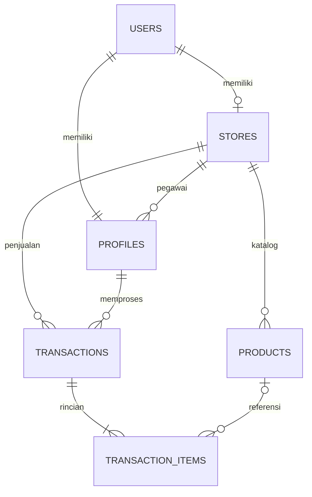

# Implementasi Waroeng.Ku

Aplikasi menyediakan satu toko per Pemilik dan satu toko per akun, dengan banyak Kasir per toko. Dua Pemilik yang mendaftar memiliki data toko terpisah. Role tidak dipilih melalui form.

## Akun dan toko

- Register mengirim nama, nama toko, email, dan password ke Supabase Auth. Confirm Email dimatikan pada konfigurasi project.
- Flutter memakai flow implicit untuk signup yang langsung mendapatkan sesi tanpa konfirmasi email; ini ditetapkan pada inisialisasi Supabase dan diperiksa dalam tes kontrak Auth.
- Trigger pembuatan pengguna membuat toko dan profil Pemilik dalam transaksi database yang sama. Nama toko kosong membatalkan seluruh pembuatan akun.
- Trigger profil ditunda hingga akhir transaksi Auth dan membaca ulang metadata `auth.users`. Auth Admin memasukkan akun terlebih dahulu, lalu menulis `app_metadata` kustom; memakai snapshot INSERT akan salah menganggap Kasir sebagai Pemilik. Regresi ini diperbaiki oleh migrasi `202611200001_cashier_auth_trigger.sql` dan diuji dengan urutan INSERT lalu UPDATE dalam satu transaksi seperti Auth Admin.

Urutan penulisan akun dan metadata tersebut mengikuti [implementasi resmi Auth Admin](https://github.com/supabase/auth/blob/v2.180.0/internal/api/admin.go#L380-L445). Trigger menggunakan `DEFERRABLE INITIALLY DEFERRED` agar pembentukan profil tetap atomik bersama akun Auth.
- Form register tidak boleh menentukan toko lama. `user_metadata` tidak dipercaya untuk memilih peran/toko.
- Pemilik membuat Kasir melalui `manage-cashier`. Fungsi memverifikasi token lewat Auth server, membaca `get_my_profile`, dan hanya mengizinkan Pemilik aktif.
- Auth Admin membuat pengguna dengan `email_confirm: true` dan `app_metadata.wk_cashier_store_id`. Hanya metadata server ini yang membentuk profil Kasir pada toko yang ditetapkan.
- Kasir mendapatkan password awal dari Pemilik, lalu dapat mengganti password sendiri. Pemilik dapat mereset password Kasir tokonya melalui fungsi server.
- Nama dan status Kasir diubah melalui `update_cashier`; menonaktifkan akun mempertahankan profil dan nota lama. Akses aktif diperiksa pada setiap RPC, sehingga sesi lama tidak melewati penonaktifan.
- Tidak ada pembuatan akun Kasir menggunakan client signup, sehingga sesi Pemilik tidak berganti.

## Model data

- `stores`: identitas toko, Pemilik, nama, alamat, telepon. Owner unik; nullable hanya untuk mempertahankan data lama tanpa Pemilik.
- `profiles`: referensi `auth.users`, nama, role, toko, status aktif. Email dan password tetap dikelola Auth.
- `products`: toko, identitas produk, modal, harga, stok, satuan.
- `transactions`: toko, ID retry, nomor nota, profil petugas, pembayaran dan total.
- `transaction_items`: referensi nota/produk dan snapshot nama, harga, jumlah, laba. Referensi produk menjadi NULL jika produk dihapus.

[ERD](diagrams/erd.png) dan [use case](diagrams/usecase.png) awal belum memuat toko, pendaftaran, pengelolaan Kasir, dan penggantian password. Model di atas serta migrasi merupakan rancangan terbaru.

## Pembatasan data

`require_user` memeriksa pengguna, status aktif, role, toko, dan kesesuaian Pemilik toko. `current_store` mengambil toko dari profil sesi, bukan parameter client. Seluruh katalog, CRUD produk/stok, pembayaran, riwayat, detail nota, dan laporan dibatasi toko tersebut.

RLS aktif pada lima tabel. Profil hanya bisa dibaca oleh akun sendiri. Tabel toko, produk, transaksi, dan item tidak dibuka langsung kepada anon/authenticated; pembacaan/perubahan dilakukan melalui fungsi tervalidasi. Fungsi internal tidak dapat dipanggil langsung dari klien. Kasir tidak menerima modal/laba dan tidak dapat mengambil laporan.

`get_cashier` memeriksa toko dan role target sebelum Auth Admin mereset password. Pemilik tidak dapat mengubah akun Pemilik lain, dirinya sendiri lewat pengelolaan Kasir, atau Kasir toko lain. Kunci secret tetap di runtime server.

## Pembayaran dan riwayat

Checkout memvalidasi keranjang, harga, stok, tunai, dan total; mengunci produk secara konsisten; lalu menyimpan nota, rincian, dan perubahan stok dalam satu transaksi. Produk toko lain ditolak dan seluruh perubahan dibatalkan. ID retry tidak bisa diambil alih akun/toko lain.

Harga dan identitas petugas berasal dari database. Snapshot barang tetap ada setelah produk berubah/dihapus. Nama toko PDF berasal dari backend toko/nota. Paging katalog 200 baris, riwayat 50 baris; laporan menghitung seluruh periode di server. Akhir periode eksklusif, waktu disimpan UTC.

ID retry bertahan selama layar pembayaran yang sama terbuka. Setelah aplikasi ditutup saat jaringan bermasalah, periksa riwayat sebelum membuat pembayaran baru. Nilai uang memakai integer, maksimal Rp 2.147.483.647 per transaksi.

## Migrasi dan validasi

Migrasi pertama adalah skema awal satu-warung. Migrasi kedua menambahkan toko dan mengganti fungsi dengan pembatasan toko. Migrasi ketiga memperbaiki waktu pembuatan profil pada transaksi Auth Admin tanpa mengubah akun/data yang sudah ada. Migrasi pertama sengaja ditolak jika tabel toko sudah ada agar tidak menurunkan pembatasan akses. Produk, profil, dan nota lama dipertahankan. Data tanpa Pemilik disimpan terpisah sampai pengelola menghubungkannya secara eksplisit.

Tes mencakup transaksi awal, upgrade dan pengulangan migrasi, register, pembuatan Kasir, data antar toko, penonaktifan sesi, handler Auth Admin, kontrak Flutter, dan alur UI. Tes PGlite menggunakan satu koneksi; uji konkurensi multi-koneksi serta Auth nyata dilakukan di Supabase aktif.

Build Android memakai NDK 27. Kotlin incremental dinonaktifkan untuk menghindari masalah cache saat project dan pub cache berada pada drive berbeda.
